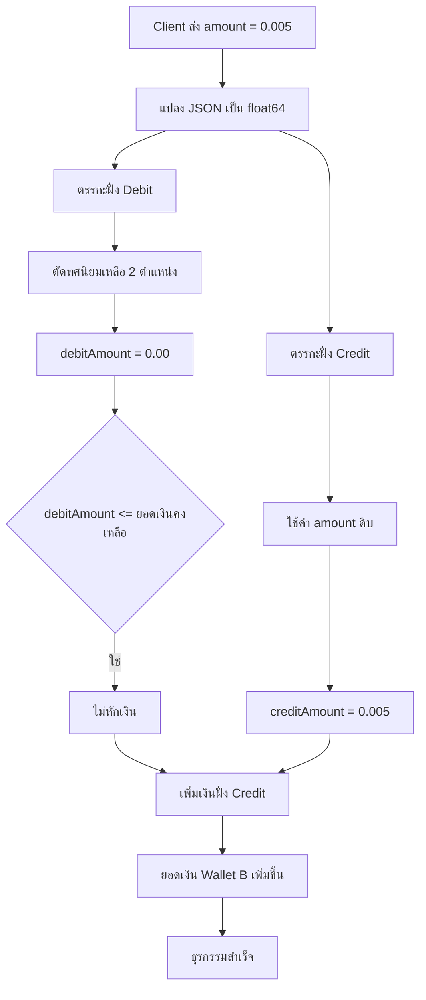

> [!danger]
> เนื้อหาในบทความนี้เปิดเผยขั้นตอนการทำงานทั้งหมดของผู้เขียน ซึ่งเป็นการกระทำที่ไม่ได้รับอนุญาตจากทางเจ้าของเว็บไซต์ การนำไปทำตามเนื้อหาอาจทำให้ท่านกระทำผิดกฎหมาย พรบ. ว่าด้วยการกระทําความผิดทางคอมพิวเตอร์ พ.ศ. 2560

หลังจากรอบก่อนเว็บ ezslot โดนเราเล่นท่า [Negative Transfer](/writeups/negative-transfer) จนทีมหลังบ้านต้องรีบออกแพตช์อุดกันไป
วันนี้เลยเกิดคำถามง่าย ๆ ขึ้นมาในหัวว่า **“ถ้ากลับไปดูอีกที… มันจะเหลืออะไรให้เราเล่นไหม?”**

คำตอบเริ่มต้นจาก endpoint เพื่อนบ้านของเรา

# Deposit API

**PATH**<br>
`POST https://api.pocketfarm.com/api/v1/bank/deposit`

**Request**<br>
```json
{
  "channel": "game",
  "amount": "1"
}
```

**Response**<br>
```json
{
  "error_code": 400,
  "message": "json: cannot unmarshal string into Go struct field ActionRequest.amount of type float64",
  "success": false
}
```

เราได้ลองเปลี่ยน amount เป็น String และระบบได้ Return กลับมาบอกเราตามตัวอย่างด้านบน

## สิ่งที่ระบบเผลอบอกเรา

จาก error message สั้น ๆ แต่พูดหมดเปลือก

- Backend เขียนด้วย Golang
- amount ถูก bind เข้า struct เป็น float64
- API ไม่ยอมรับ string
- ต้องการตัวเลขจริงๆ แบบ IEEE-754

และตรงนี้แหละ… กลิ่นปัญหามาเต็ม 👃

> [!Bug]
> float64 + เงิน = ระเบิดเวลา
>
> float64 ไม่ได้ถูกออกแบบมาเพื่อระบบการเงิน:
> - เก็บค่าเป็นเลขฐานสอง ทำให้ทศนิยมฐานสิบส่วนใหญ่แทนค่าไม่ตรง
> - เกิด rounding error สะสมเมื่อมีการบวก/ลบหลายครั้ง
> - การปัดเศษตาม IEEE 754 ให้ผลลัพธ์ที่ไม่เหมาะกับเงิน
>
> ระบบการเงินต้องใช้ integer หรือ decimal เท่านั้น

สิ่งที่ float64 เห็น
```
0.001 → 0.001000000000000000020816681711721685132943093776702880859375
0.002 → 0.00200000000000000004163336342344337026588618755340576171875
0.003 → 0.002999999999999999889865875957184471189975738525390625
0.004 → 0.0040000000000000000832667268468867405317723751068115234375
0.005 → 0.00499999999999999979183363597695253414213657379150390625
0.006 → 0.00600000000000000012490009027049989125645160675048828125
0.007 → 0.0069999999999999997779553950749686919152736663818359375
0.008 → 0.008000000000000000166533453693773481063544750213623046875
0.009 → 0.0089999999999999993199885935428202140331268310546875
```

> [!Tip]
> หมายเหตุ:
> นี่ไม่ใช่บั๊กแต่เป็นธรรมชาติของเลขฐานสอง
>
> float64 แทนค่าเลขด้วย binary floating-point  
> ทำให้เลขทศนิยมฐาน 10 ส่วนใหญ่ไม่สามารถแทนค่าได้อย่างแม่นยำ
> (ยกเว้นบางค่าที่เป็นเศษส่วนของ 2)
>
> ค่าบางตัวอาจดูเหมือน “ตรง” เพราะ error เล็กมาก
> แต่ค่าบางตัวเช่น 0.005 ถูกแทนค่าเป็นค่าที่ต่ำกว่า
> เมื่อเกิดการปัดเศษหรือคำนวณซ้ำ จะให้ผลลัพธ์ผิดพลาดสะสม
>
> ความคลาดเคลื่อนเพียงเล็กน้อยนี้
> เพียงพอที่จะทำให้ระบบการเงินพังได้

## เมื่อ float64 คอมโบคู่กับ “ทศนิยม 2 ตำแหน่ง”

สมมติ backend ทำอะไรสักอย่างแนว ๆ นี้:

- truncate
- floor
- cast เป็น int หลังคูณ 100
- หรือ logic ปัดเศษแบบบ้าน ๆ

ผลลัพธ์จะออกมาแบบนี้

```
0.004  →  0.00 // ปัดลง
0.005  →  0.00 // ปัดลง
0.006  →  0.01 // ปัดขึ้น
```

เพราะในสายตาเครื่อง

```
0.005 === 0.00499999999999999979183363597695253414213657379150390625
```

หมายความว่าถ้าเราส่งยอด **0.005** ระบบจะเข้าใจว่าส่ง **0.00499999999999999979183363597695253414213657379150390625** และเมื่อคอมโบคู่กับทศนิยมสองตำแหน่ง นั่นยิ่งเพี้ยนไปกันใหญ่ เพราะมันจะปัดเศษลงมาเป็น **0.00** ทำให้เงินไม่ถูกหักจากกระเป๋า A

# แก่นของปัญหาจริงๆ คือ “ใช้ค่าเดียวกันคนละวิธี”

ตรงนี้เองที่บั๊กเริ่มทำงานจริง แม้ต้นทางจะเป็นเงินก้อนเดียวกัน แต่ระบบกลับนำค่าเดียวกันไปใช้คนละวิธีในคนละฝั่ง

### ฝั่ง Debit (หักเงิน)

ฝั่งนี้ backend มักจะ “กลัวทศนิยมเกิน” เลยมีขั้นตอน normalize

- truncate ให้เหลือ 2 ตำแหน่ง
- int(amount * 100)
- math.Floor(amount*100) / 100

แต่สิ่งที่ dev ไม่รู้ก็คือ **ค่า amount ที่เข้ามาไม่ใช่ 0.005 จริงๆ**

ในหน่วยความจำมันคือ

```
0.00499999999999999979...
```

พอเอาไป normalize

```
amount * 100 = 0.4999999999999999
floor / truncate = 0
=> debitAmount = 0.00
```

ผลคือ
- ระบบคิดว่า “หัก 0 บาท”
- ผ่านเงื่อนไข balance check

### ฝั่ง Credit (เพิ่มเงิน)

ตรงนี้แหละที่บางคนพลาด

ฝั่ง credit มักคิดแบบนี้

> “เราเช็ค balance ไปแล้ว งั้นใช้ amount เดิมเพิ่มเข้าไปเลย”

ผลคือ ไม่ normalize ซ้ำ

```
creditAmount = amount
creditAmount = 0.005
```

| ขั้นตอน | ค่า |
|---|---|
| Client ส่ง | 0.005 |
| float64 จริง | 0.00499999999999999979 |
| Debit normalize | 0.00 |
| Balance check | ผ่าน |
| Credit ใช้ค่าเดิม | +0.005 |

## สรุป

กฎเหล็กของระบบการเงินคือ
**เงิน 1 ก้อน ต้องถูกแปลงค่า ครั้งเดียว และใช้ค่าเดียวกัน ทั้ง debit / credit / log / DB และถ้าเห็น float64 อยู่ใกล้ยอดเงิน แปลว่ามีคนกำลังจะซวย**

ปัญหาไม่ได้อยู่ที่ float64 อย่างเดียวแต่อยู่ที่การใช้ “เงินก้อนเดียวกันคนละวิธี” ในคนละฝั่ง

สิ่งที่เกิดขึ้นจริงคือ

- Backend ใช้ float64 รับยอดเงิน (IEEE-754)
- ค่าที่ client ส่ง เช่น 0.005 ไม่เคยเป็น 0.005 จริงในหน่วยความจำ
- ฝั่ง Debit:
  - เอา amount ไป normalize (truncate / floor / cast)
  - ได้ค่า 0.00
  - ผ่าน balance check → ไม่หักเงิน
- ฝั่ง Credit:
  - ใช้ amount เดิม (float64 ที่ไม่ normalize)
  - เพิ่มเงิน +0.005

> ❝ ถ้า debit กับ credit ไม่ใช้ค่าที่ normalize ตัวเดียวกัน ต่อให้ใช้ decimal ก็พังได้ ❞

## แผนผัง

