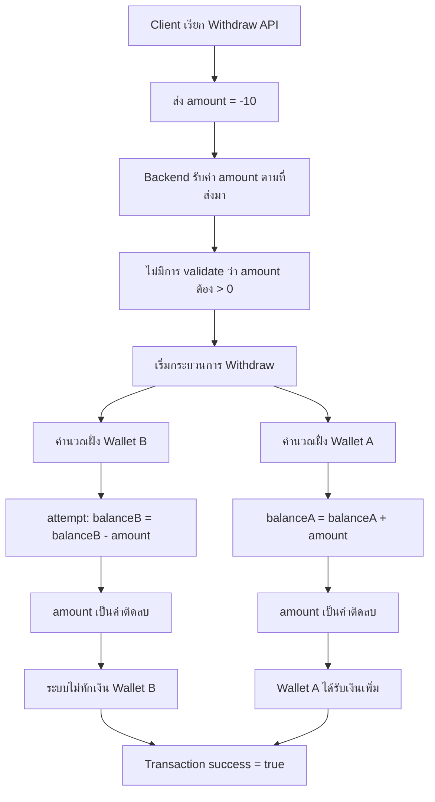

> [!danger]
> เนื้อหาในบทความนี้เปิดเผยขั้นตอนการทำงานทั้งหมดของผู้เขียน ซึ่งเป็นการกระทำที่ไม่ได้รับอนุญาตจากทางเจ้าของเว็บไซต์ การนำไปทำตามเนื้อหาอาจทำให้ท่านกระทำผิดกฎหมาย พรบ. ว่าด้วยการกระทําความผิดทางคอมพิวเตอร์ พ.ศ. 2560

วันนี้ว่างๆ เลยอยากหาอะไรทำเล่นๆก็ไปเจอเว็บ ezslot เลขลองสมัครเข้าไปดูสักหน่อย ส่วนตัวผมชอบ UI ของเกม lotto มากเลยเขาทำดีมาก แต่แล้วผมก็ไปสะดุดเจอฟีเจอร์นึงในเว็บ มันชื่อว่า **Pocket Farm** เป็นระบบ wallet ไว้สำหรับออมเงิน หรือโยกเงินไว้เก็บสำรอง

![[pocketfarm.jpg]]

<p align="center">
    <em>(รูปที่ 1 ฟีเจอร์ของระบบ Pocket Farm)</em>
</p>

# เริ่มต้น

อธิบายพอสังเขปคือ
- ตัวเว็บ ezslot มีระบบกระเป๋า เราจะใช้เรียกว่า **wallet A**
- เว็บ ezslot มีฟีเจอร์ที่เป็นกระเป๋าออมเงินชื่อ pocketfarm เราจะใช้เรียกว่า **wallet B**

เราได้ลองโยกเงินจาก **wallet A** เข้าไปเก็บที่ **wallet B** และโยกเงินจาก **wallet B** ออกมาที่ **wallet A**
เพื่อดูว่า API รับส่งอะไรกันบ้างสิ่งที่น่าสนใจคือ

# Withdraw API

**PATH**<br>
`POST https://api.pocketfarm.com/api/v1/bank/withdraw`

**Request**<br>

```json
{
  "channel": "game",
  "amount": -10
}
```

เราได้ลองเปลี่ยน amount เป็นยอดติดลบเพื่อเช็คอาการเบื้องต้น แต่สิ่งที่ได้ตอบกลับคือ

```json
{
  "success": true,
  "data": { ... }
}
```

ผลลัพท์คือยอดเงินจากกระเป๋า **wallet B** ไม่ลดลง แต่ยอดเงินที่ **wallet A** ถูกเพิ่ม

> [!Bug]
> สาเหตุของบั๊กนี้เกิดจาก Business Logic ผิดพลาดในการจัดการเครื่องหมายของ ```amount```

## สรุป

ระบบ **Withdraw API** ควรถูกออกแบบมาโดยสมมติว่า

- ```amount``` **ต้องเป็นค่าบวกเสมอ**
- ทิศทางการเงินถูกกำหนดจากเส้น (withdraw / deposit) ไม่ใช่จากเครื่องหมายของตัวเลข

แต่ในกรณีนี้ ระบบกลับ

- ไม่ **validate ค่า** ```amount``` **ว่าต้องมากกว่า 0**
- นำ ``amount`` ไปคำนวณโดยตรงในสมการลักษณะนี้

```
walletB.balance = walletB.balance - amount
walletA.balance = walletA.balance + amount
```

เมื่อส่ง ```amount = -10```
สมการจะกลายเป็น:

```
walletB.balance = balance - (-10) = balance + 10   (แต่ฝั่งนี้ถูก block หรือ normalize)
walletA.balance = balance + (-10) = balance - (-10) = balance + 10
```

แต่เนื่องจากฝั่ง **wallet B**

- อาจมีการป้องกันไม่ให้ยอดเงินติดลบ
- หรือมีการ normalize / truncate / reject เฉพาะตอน “หักเงิน”

ผลลัพธ์จึงกลายเป็น

- **wallet B ไม่ถูกหัก**
- **wallet A ได้รับเงินเพิ่ม**

ซึ่งคืออาการของ

- การใช้ค่าเดียวกัน (amount) แต่ตีความคนละความหมายในแต่ละฝั่ง
- เชื่อ input มากเกินไป โดยไม่ผูกตรรกะกับ context ของ API

> **❝ เด็ก ป.4 รู้ว่าลบเจอลบเป็นบวก**
> **แต่คนเขียนระบบนี้ไม่รู้ หรืออาจสอบตกคณิตศาสตร์ขั้นพื้นฐานก็เป็นได้ ❞**

## แผนผัง



![[statement.png]]

<p align="center">
  <em>(รูปที่ 2 รายการเดินบัญชี)</em>
</p>

> "ขอบคุณสำรหับค่ากาแฟครับ 🙏"